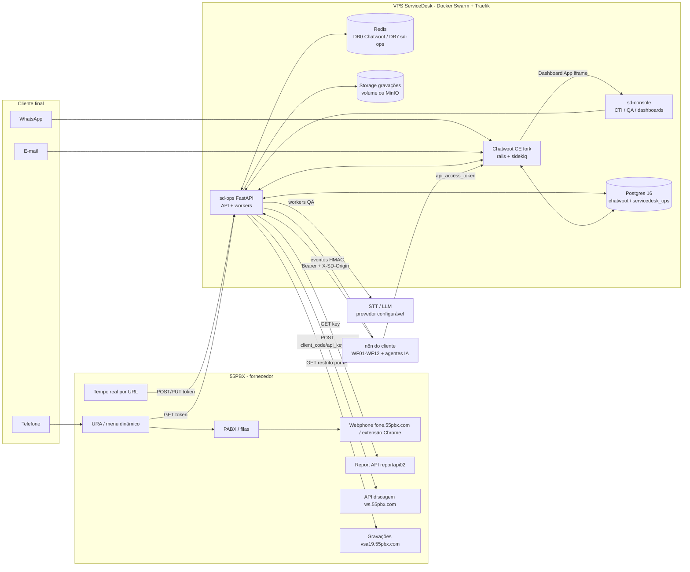
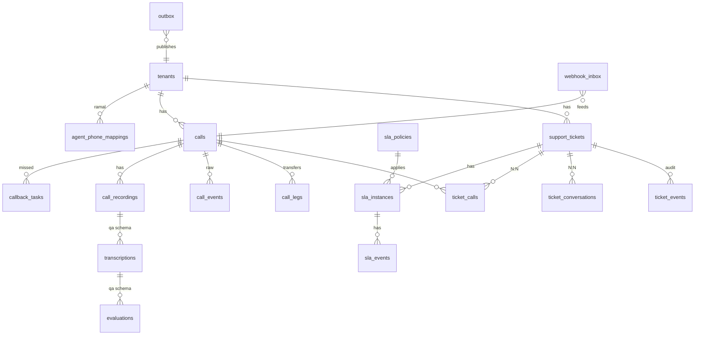

# Arquitetura: Central de Suporte (ServiceDesk + 55PBX + sd-ops + IA + n8n)

Versão 1, de 2026-10-13 (agente A1). Escopo: prompt mestre §3. Complementa `DESIGN-MIGRACAO.md` (migração do Zendesk), `INTEGRACAO-55PBX.md` (ponte existente) e os documentos de `docs/integrations/`.

## 1. Decisões (ADR resumido)

| # | Decisão | Alternativas avaliadas | Por quê |
|---|---|---|---|
| AD1 | **Telefonia caminho B+A**: Dashboard App "CTI" no Chatwoot (contexto, discar, registro) + webphone/extensão oficial da 55PBX com o áudio | **C** (voz no navegador do Chatwoot) | C exige recurso premium do Chatwoot (só Twilio/WhatsApp Calling, sem SIP/PBX de terceiros — `PROVIDER_CAPABILITIES.md` §2) ou WebRTC/SIP da 55PBX não documentado. B+A usa só o que é documentado (eventos, Report, discagem) e não troca a 55PBX. O áudio nunca passa pelo nosso servidor |
| AD2 | **Ticket híbrido**: a conversa do Chatwoot é a tela de trabalho; o **sd-ops** mantém o domínio de ticket de negócio | (a) só conversas + atributos; (b) tabelas novas no banco do Chatwoot; (c) helpdesk separado | (a) não dá máquina de estados, auditoria, N:N com chamadas nem SLA; (b) viola "não alterar tabelas do Chatwoot"; (c) duplica a interface. O histórico importado (`display_id` = nº Zendesk, `zd_*`) continua válido |
| AD3 | **sd-ops** = evolução da pbx-bridge (FastAPI/Python), banco **`servicedesk_ops`** separado no Postgres do ServiceDesk, Alembic, schemas `ops` (A2) e `qa` (A3) | SQLite da pbx-bridge; schema dentro do banco `chatwoot` | SQLite não escala nem permite réplicas/joins; schema no banco do Chatwoot acopla migrações e backups ao upstream. Mesmo servidor Postgres = sem duplicar infraestrutura |
| AD4 | Redis do ServiceDesk, **DB 7**, stream **`sd:events`**, padrão outbox | Kafka/RabbitMQ; Sidekiq do Chatwoot | Volume baixo (~70 ligações/dia útil); Redis já existe. DB 0 é do Chatwoot, DB 5 do staging |
| AD5 | Storage S3-compatível com **adapter** (padrão volume local; MinIO opcional) | MinIO obrigatório | Os MinIOs da VPS são de outros clientes (`redetur_minio`, `contractmanager_minio`): não compartilhar. Volume local resolve ~12 GB/ano (MP3) |
| AD6 | **n8n orquestra** (WF01–WF12): notificações, agendamentos, relatórios, escalonamento; **lógica transacional fica no sd-ops** | Lógica no n8n | Idempotência, máquina de estados e auditoria precisam de transação e testes |
| AD7 | CTI, console de QA e dashboards = app web **sd-console** (A3), servido em `/sd-console/` no mesmo site do Chatwoot | Customizar o Vue do Chatwoot | Menor acoplamento com o upstream; autenticação por troca de token (`integrations/CTI_AUTH.md`) |
| AD8 | **CE sem `enterprise/`**; nada pago | — | Política do projeto (`DESIGN-MIGRACAO.md` §4.1) |

## 2. Visão de contexto



## 3. Componentes

| Componente | Responsabilidade | Dono | Tecnologia |
|---|---|---|---|
| Chatwoot CE (fork) | Interface principal: conversas = tela do ticket, contatos, inboxes, macros, views, notas, CSAT de conversa | rodadas anteriores | Rails 7, Vue 3, Sidekiq |
| sd-ops API | Webhooks (55PBX, Chatwoot, URA), REST `/sd-ops/api/v1` (OpenAPI), autenticação CTI, RBAC, tenants | A2 | FastAPI, SQLAlchemy, Alembic |
| sd-ops workers | Normalização e merge de eventos, sincronização com o Chatwoot, gravações, reconciliação Report02, SLA, outbox → `sd:events`, dispatcher para o n8n | A2 | Python asyncio/RQ-like sobre Redis Streams |
| qa-pipeline | Transcrição, resumo, QA por rubrica, alertas (`qa.*`) | A3 | Python, provedores STT/LLM por adapter |
| sd-console | CTI no Dashboard App, console de QA, dashboards (telefonia, tickets, QA) | A3 | app web (SPA) |
| n8n | WF01–WF12 (orquestração, notificação, relatórios) | A1 | n8n do cliente |
| pbx-bridge | Ponte atual (dormente). **Substituída pelo sd-ops** na ativação; mesmo código de normalização evoluído | A2 | FastAPI + SQLite |

## 4. Fluxo principal: ligação → contato → ticket → conversa

```mermaid
sequenceDiagram
    autonumber
    participant P as 55PBX
    participant W as sd-ops webhook
    participant K as worker
    participant C as Chatwoot
    participant D as servicedesk_ops
    participant R as Redis sd:events
    participant N as n8n
    P->>W: POST evento (header token)
    W->>D: INSERT webhook_inbox (bruto, dedupe_key)
    W-->>P: 202
    K->>D: lock por (central_id, call_id); merge em calls/call_events
    K->>C: GET contacts/search?q=+55... (variantes 9º dígito)
    alt não existe
      K->>C: POST contacts (E.164)
    end
    K->>D: política de abertura (cliente, fila, canal)
    alt reaproveitar ticket aberto do mesmo contato/assunto
      K->>D: INSERT ticket_calls (vínculo)
    else novo
      K->>D: INSERT support_tickets (protocolo) + ticket_events
      K->>C: POST conversations (inbox Telefone 55PBX) + custom_attributes
    end
    K->>C: nota privada "Registro de ligação" (source_id idempotente)
    K->>C: assignments (ramal→agente, fila→time)
    K->>D: outbox call.started / call.ended / call.missed
    D->>R: publicador XADD
    R->>K: n8n-dispatcher
    K->>N: POST WF01/WF02/WF03 (X-SD-Webhook-Token)
```

## 5. Dados

Banco `servicedesk_ops` (Postgres do ServiceDesk), UTC, `tenant_id` em todas as tabelas de negócio, soft delete onde há exclusão, Alembic.



Domínios do prompt (§14) → tabelas: `tenants`, `integration_accounts`, `integration_credentials_refs` (só referência ao segredo, nunca o valor), `agent_phone_mappings`, `support_tickets`, `ticket_events`, `ticket_conversations`, `ticket_activities`, `calls`, `call_legs`, `call_events`, `call_recordings`, `callback_tasks`, `sla_policies`, `sla_instances`, `sla_events`, `csat_responses`, `automation_executions`, `automation_routes`, `webhook_inbox`, `outbox`, `idempotency_keys`, `integration_sync_logs`, `audit_events` (schema `ops`); `transcriptions`, `transcription_segments`, `evaluations`, `criteria_scores`, `review_events`, `rubrics` (schema `qa`). A definição física é do A2/A3 (migrations).

Dados do Chatwoot continuam no banco `chatwoot` e só são tocados pela **API pública**.

## 6. Rede e exposição

| Rota pública (Traefik, `websecure`) | Destino | Observação |
|---|---|---|
| `Host(<domínio>)` | Chatwoot rails | existente |
| `Host(<domínio>) && PathPrefix(/sd-ops)` | sd-ops API (prioridade 100) | webhooks, API do console, URA |
| `Host(<domínio>) && PathPrefix(/sd-console)` | sd-console (estático) | mesmo site → cookie primário |
| `Host(<domínio>) && PathPrefix(/integracoes/55pbx)` | sd-ops (alias legado da pbx-bridge) | opcional |

Rede interna: `servicedesk_internal` (overlay da stack existente): sd-ops fala com `http://servicedesk_rails:3000`, `servicedesk_postgres:5432`, `servicedesk_redis:6379`. Saída para internet: 55PBX, provedor de STT/LLM, n8n.

## 7. Requisitos não funcionais

| Item | Meta |
|---|---|
| Webhook | p95 < 300 ms; nunca chama serviço externo no request |
| Ligação → conversa visível | p95 < 10 s após o evento final |
| Gravação → transcrição → QA | < 30 min (assíncrono) |
| Disponibilidade | eventos não se perdem: inbox persistida + reconciliação Report02 |
| Volume de referência | 17,6 mil ligações/ano (≈ 70/dia útil, picos de 10/min); 9,5 mil gravações (~640 h faladas); 151 mil tickets/ano |
| Observabilidade | health por componente, logs JSON com `correlation_id`, métricas de fila, DLQ, alertas (`RUNBOOK.md`) |

## 8. O que muda em relação à pbx-bridge

| pbx-bridge (hoje, dormente) | sd-ops (alvo) |
|---|---|
| SQLite, 1 réplica | Postgres `servicedesk_ops` |
| Conversa = registro da ligação | Ticket de negócio + vínculo N:N com conversa e chamada |
| Fila interna em SQLite | Redis Streams + outbox |
| Gatilhos Zendesk reproduzidos na ponte | Regras de abertura parametrizáveis (`TICKET_DOMAIN.md` §5) |
| Sem eventos para o n8n | `sd:events` → WF01–WF12 |
| Áudio anexado como MP3 na nota | Storage próprio + URL assinada; MP3 na nota opcional (paridade) |
