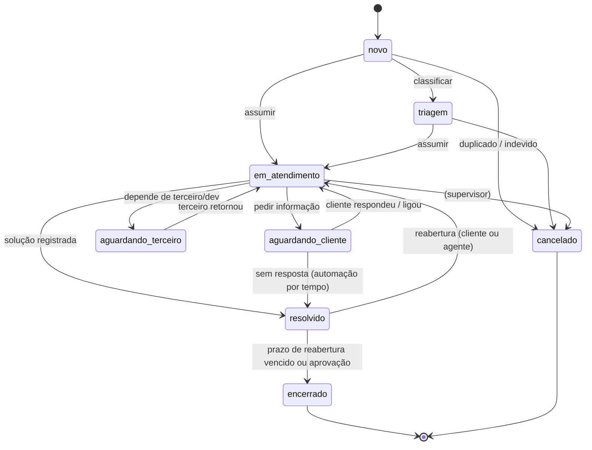

# Domínio de ticket (sd-ops) e mapeamento com a conversa do Chatwoot

Versão 1, de 2026-10-13 (agente A1). Implementação: A2 (schema `ops` do banco `servicedesk_ops`). Onde o código do A2 divergir, vale o código e o `integrations/WEBHOOK_CONTRACTS.md` §8; este documento registra a regra de negócio.

## 1. Modelo híbrido

| Camada | O que guarda | Quem escreve |
|---|---|---|
| **Conversa do Chatwoot** (tela de trabalho) | mensagens, notas, anexos, responsável, time, etiquetas, prioridade, status nativo, `zd_*` (histórico importado: `display_id` = nº do Zendesk) | agentes, macros, importador, sd-ops (via API) |
| **Ticket de negócio** (`ops.support_tickets`) | protocolo, estado de negócio, tipo, categoria/subcategoria, severidade, origem, SLA, motivo e aprovação de encerramento, vínculos N:N com chamadas e conversas, auditoria | sd-ops (API, workers, CTI) |

Um ticket pode ter **várias** conversas (ex.: ligação + WhatsApp + e-mail do mesmo problema) e várias chamadas; uma conversa tem **um** ticket primário (`ops.ticket_conversations.is_primary`) e pode estar relacionada a outros.

Tickets históricos do Zendesk **não** são recriados no sd-ops em massa: ganham ticket de negócio sob demanda (primeira mudança de estado feita pelo CTI/sd-ops ou reabertura), com `origin=zendesk_import` e `legacy_ticket_number = display_id`.

## 2. Estados

| Estado (`state`) | Rótulo | Categoria | Conversa (status nativo) | `zd_status` (rótulo exibido) |
|---|---|---|---|---|
| `novo` | Novo | new | `open` | Novo |
| `triagem` | Triagem | open | `open` | Aberto |
| `em_atendimento` | Em atendimento | open | `open` | Em andamento |
| `aguardando_cliente` | Aguardando cliente | pending | `snoozed` (sem data: volta com a resposta do cliente) | Pendente |
| `aguardando_terceiro` | Aguardando terceiro | hold | `snoozed` (com `snoozed_until` se houver prazo) | Desenvolvimento / Devolvido (conforme `sub_state`) |
| `resolvido` | Resolvido | solved | `resolved` | Resolvido |
| `encerrado` | Encerrado | closed | `resolved` | Concluído (+ `zd_status_sistema` = Fechado) |
| `cancelado` | Cancelado | closed | `resolved` | Concluído, `zd_motivo_encerramento` = Cancelado |

Mapeamento canônico (decisão do projeto, igual ao importador): `new`/`open` → `open`; `pending`/`hold` → `snoozed`; `solved`/`closed` → `resolved`. O status `pending` nativo do Chatwoot **não** é usado (reservado a bot/IA).

Os 11 rótulos `zd_status` do histórico (Novo, Aberto, Em andamento, Reaberto, Pendente, Desenvolvimento, Devolvido, Desenvolvimento Concluído, Resolvido, Concluído, Respondido cliente) são lidos assim: categoria → estado acima; `Reaberto` → `em_atendimento` com `reopen_count ≥ 1`; `Desenvolvimento`/`Devolvido`/`Desenvolvimento Concluído` → `aguardando_terceiro` com `sub_state`; `Respondido cliente` → `resolvido`.

**Escalonamento** não é estado: é um atributo (`escalation_level` 0–3, `escalated_to`) com evento próprio, válido em `triagem`, `em_atendimento` e `aguardando_*`.

## 3. Transições

| Regra | Detalhe |
|---|---|
| Transição inválida | `409` na API (`POST /tickets/{id}/transitions`) |
| Quem pode | agente: até `resolvido` e reabrir de `resolvido`; supervisor/admin: `encerrado`, `cancelado`, aprovar encerramento (`integrations/CTI_AUTH.md` §4) |
| Exigências ao resolver | `categoria`, `motivo/disposição` e `solução` preenchidos (configurável por tipo/formulário) |
| Exigências ao encerrar | motivo de encerramento; aprovação quando a política exigir (ex.: severidade alta) |
| Encerrado é final | nova ocorrência do mesmo assunto após `encerrado` cria **ticket novo** relacionado (`related_ticket_id`), como no Zendesk ("follow-up") |
| Reabertura | `resolvido → em_atendimento` incrementa `reopen_count`, reinicia o SLA de resolução e gera `ticket.reopened` |
| Auditoria | toda transição grava `ops.ticket_events` (de, para, ator, origem `cti`/`chatwoot`/`n8n`/`sistema`, motivo, `correlation_id`) |

### 3.1 Sincronização conversa ↔ ticket

| Origem da mudança | Efeito |
|---|---|
| sd-ops muda o estado | `toggle_status` + `custom_attributes` (`sd_estado`, `zd_status`, `sd_protocolo`) na conversa primária; marca `sd_last_writer=sd-ops` |
| Agente muda o status no Chatwoot (webhook `conversation_status_changed`) | `resolved` → `resolvido` (se as exigências estiverem ok; senão registra pendência e alerta no CTI); `open` em ticket `resolvido` → `em_atendimento` (reabertura); `snoozed` → `aguardando_cliente` |
| Agente muda `zd_status` (painel/macro) | mapeia pelo rótulo (§2) |
| Cliente responde (mensagem `incoming`) em `aguardando_cliente` | `em_atendimento` (o próprio Chatwoot já reabre a conversa) |
| Mudança vinda do n8n | aplicada via API do sd-ops (nunca direto no Chatwoot) com `X-SD-Origin: n8n` |

Conflito: a última escrita vence, mas a mudança vinda do Chatwoot que contradiz uma regra (ex.: resolver sem categoria) não é perdida: fica registrada e o ticket recebe `needs_attention=true`.

## 4. Protocolo

| Forma | Formato | Exemplo | Uso |
|---|---|---|---|
| Legível | `<PREFIXO>-<AAAA>-<sequência 6 dígitos>` (prefixo por tenant, ex. `B2B`) | `B2B-2026-000123` | tela, e-mail, WhatsApp |
| Numérica (URA) | `<AAAA><sequência 6><dígito verificador>` (DV Luhn) | `20260001237` | digitável no telefone; o DV rejeita erros de digitação sem consultar o banco |

Sequência por tenant e ano, gerada em transação (`ops.protocol_sequences`, `UPDATE ... RETURNING`), única e pesquisável (índices em ambas as formas). A forma numérica é exposta à URA somente pelo endpoint protegido (`integrations/WEBHOOK_CONTRACTS.md` §8.9).

## 5. Política de abertura automática (`ops.ticket_open_rules`)

Regras avaliadas por prioridade, com escopo por **tenant/cliente, conta, fila, canal e direção**:

| Política | Comportamento |
|---|---|
| `all_calls` | toda chamada recebida abre/relaciona ticket |
| `answered_only` | só atendidas (perdidas viram `callback_tasks`, sem ticket) |
| `missed_only` | só perdidas/abandonadas (ticket de callback) |
| `reuse_open` | se o contato tem ticket aberto (não final) **do mesmo assunto/fila** nos últimos N dias (padrão 7), relaciona a chamada a ele |
| `new_occurrence` | sempre ticket novo, relacionado ao anterior |
| `outbound_link` | chamada ativa (click-to-call) relaciona ao ticket de onde partiu (`dial` com `ticket_id`); sem origem → `reuse_open` |
| `require_human` | ambíguo (vários tickets abertos, contato não identificado, número compartilhado) → chamada fica `needs_classification` e aparece no CTI para o agente escolher |
| `none` | não abre (ex.: internas) |

Padrão sugerido para a B2B (reproduz o Zendesk e melhora): receptiva `reuse_open` → senão `all_calls`; ativa `outbound_link`; interna `none` (só registro); perdida/abandonada na fila → `missed_only` com callback e prioridade alta; retida na URA fora do expediente → callback no próximo dia útil. Recusa de operador **não** abre ticket.

Identificação do cliente: telefone E.164 (com e sem o 9º dígito); depois e-mail/identificador. **Nunca** mesclar por nome ou por sugestão de IA: candidatos ambíguos ficam para decisão humana (merge só manual, `POST /actions/contact_merge`).

## 6. Campos do ticket (mínimo)

`id` (UUID), `tenant_id`, `protocol`, `protocol_numeric`, `legacy_ticket_number`, `state`, `sub_state`, `subject`, `description`, `type`, `category`, `subcategory`, `priority` (`urgent/high/medium/low` = Chatwoot), `severity` (1–4), `department/team_id`, `assignee_id`, `contact_id`, `company_id`, `channel_origin`, `origin` (`call`, `chatwoot`, `api`, `zendesk_import`), `escalation_level`, `reopen_count`, `due_at`, `first_response_at`, `resolved_at`, `closed_at`, `close_reason`, `close_approved_by`, `needs_attention`, `created_at`, `updated_at`, `deleted_at` (soft delete). Vínculos: `ticket_conversations`, `ticket_calls`, `ticket_activities` (disposição, pendências, agendamentos), `ticket_events` (auditoria), `sla_instances`.

## 7. SLA (resumo)

Políticas por tenant, cliente/contrato, canal, prioridade, tipo, time e fila; métricas: primeira resposta, próxima resposta, resolução; horário comercial (seg–sex 09–18 Brasília, feriados) ou corrido; pausa em `aguardando_cliente`/`aguardando_terceiro` (configurável). As 3 políticas atuais do Zendesk (Overbooking 3 h, Suporte 6–8 h, Times 10 h, só 1ª resposta, horário comercial) são o ponto de partida. **SLA de telefonia** (nível de serviço da fila, TME) é separado e vem da 55PBX. Alertas: `sla.warning`/`sla.breached` → WF10.

---

## 8. Implementação sd-ops (A2)

Versão 1, de 2026-10-13. Código: `sd_ops/tickets.py`, `sd_ops/sla.py`, `sd_ops/calls.py` (política de abertura), `sd_ops/chatwoot_sync.py` (sincronização). Tabelas no schema `ops` do banco `servicedesk_ops` (migration Alembic `0001`). Testes: `tests/sdops/test_scenarios.py` (cenários 22 e 23) e `tests/sdops/test_api.py`.

### 8.1 O que está implementado

| Regra (§1–§7) | Implementação | Diferença em relação ao desenho |
|---|---|---|
| Estados e mapa para a conversa | `tickets.STATES` e `tickets.CHATWOOT_MAP`: `novo`/`triagem`/`em_atendimento` → `open`; `aguardando_*` → `snoozed`; `resolvido`/`encerrado`/`cancelado` → `resolved`. `zd_status`: Novo, Aberto, Em andamento, Pendente, Pendente, Resolvido, Concluído, Concluído; `zd_status_sistema`: Novo, Aberto, Aberto, Pendente, Em espera, Resolvido, Fechado, Fechado | `aguardando_terceiro` grava `zd_status = Pendente` (sem `sub_state` Desenvolvimento/Devolvido por enquanto) |
| Transições | `tickets.TRANSITIONS`; inválida → **409**; `encerrado`/`cancelado` exigem supervisor/admin (ou escopo `tickets:close`); cancelar exige motivo (422) | cancelar é permitido de qualquer estado aberto (supervisor). Exigências de categoria/solução ao resolver ainda **não** são validadas |
| Reabertura | `resolvido → em_atendimento`: `reopen_count + 1`, SLA de resolução reiniciado, evento `ticket.reopened`. De `encerrado`/`cancelado`: ticket de continuação com `parent_ticket_id`, mesmas conversas e estado `em_atendimento` | — |
| Escalonamento | `POST /tickets/{id}/escalate`: `escalation_level + 1`, sobe a prioridade (ou a informada), troca de time opcional, SLA recalculado, evento `ticket.escalated` | sem `escalated_to` separado (usa `team_id`/`team_name`) |
| Protocolo | `PREFIXO-AAAA-NNNNNN` + numérico `AAAANNNNNN` + DV Luhn (11 dígitos), contador por tenant e ano em `ops.protocol_counters` (`INSERT … ON CONFLICT DO UPDATE … RETURNING`); índices únicos nas duas formas | tabela chama `protocol_counters` |
| Política de abertura | `ops.ticket_open_rules` = `mode` (`all`, `answered`, `missed`, `none`) × `reuse` (`reuse_open`, `new`, `ask`) + `reuse_window_hours`, por direção e fila (`fnmatch`), avaliadas por `sort`. Padrão semeado: interna → `none`; receptiva e ativa → `all` + `reuse_open` 24 h. Click-to-call com `ticket_id` → vínculo `dial` (equivale a `outbound_link`). `ask` → `calls.needs_classification` (`GET /calls?needs_classification=true`) até o agente criar ou vincular | reaproveitamento por **contato/telefone** (não por assunto/fila); janela padrão 24 h (A1 sugeriu 7 dias) |
| Perdidas | ticket criado no início é classificado no fim: `category = ligacao_perdida`, `subcategory = <outcome>`; `callback_tasks` | — |
| Identificação | E.164 com e sem o 9º dígito, correspondência exata do telefone; mais de um contato com o mesmo telefone → usa o de menor id **sem mesclar** e marca `needs_identification`; nome/e-mail do contato copiados ao ticket | merge manual de contatos não é feito pelo sd-ops |
| Sincronização sd-ops → conversa | `chatwoot.sync_ticket` (outbox): `custom_attributes` `sd_ticket_id`, `sd_protocolo`, `sd_protocolo_numerico`, `sd_ticket_status`, `zd_status`, `zd_status_sistema` + `toggle_status` | atributo de estado chama `sd_ticket_status` (não `sd_estado`) |
| Conversa → sd-ops | webhook do Chatwoot: `resolved` → `resolvido`; `open` em `resolvido` → reabertura; `open` em `aguardando_*` → `em_atendimento`; `snoozed` em `novo`/`triagem`/`em_atendimento` → `aguardando_cliente`; mensagem `incoming` em `aguardando_cliente` → `em_atendimento`. Anti-eco: `ticket_conversations.last_synced_status` (gravado antes do `toggle_status`) | sem `needs_attention` |
| Atividades | `POST /tickets/{id}/notes` com `kind` `registro` / `disposicao` / `nota_interna` e `disposition` livre (categoria, motivo, resultado, pendências, agendamento, ações); espelhada como nota privada na conversa primária (`source_id sdops:<ticket>:atividade:<id>`) | — |
| Auditoria | `ops.ticket_events` (criação, transição, campo alterado, escalonamento, vínculos, 1ª resposta) e `ops.audit_events` para prioridade, responsável, time e status | — |
| Concorrência | `PATCH /tickets/{id}` aceita `version` (409 se mudou) | — |

Prioridades: `baixa`, `normal`, `alta`, `urgente` (o desenho sugeria os nomes do Chatwoot).

### 8.2 SLA implementado

- Horário "Padrão B2B" (`ops.business_hours`): seg–sex 09:00–18:00 `America/Sao_Paulo`, feriados em lista. Soma de minutos úteis, segundos úteis entre duas datas e próximo horário aberto (`sla.BusinessHours`).
- Políticas `ops.sla_policies` por prioridade, time e canal (primeira regra ativa por `sort`). Padrão semeado: urgente 30 min / 4 h; alta 1 h / 8 h; normal 4 h / 27 h úteis (3 dias); baixa 8 h / 45 h úteis (5 dias). As metas do Zendesk (Overbooking 3 h, Suporte 6–8 h, Times 10 h de 1ª resposta) entram como políticas por time quando o cliente confirmar.
- `ops.sla_instances` (uma por métrica) e `ops.sla_events` (`started`, `paused`, `resumed`, `met`, `stopped_late`, `restarted`, `recalculated`, `breached`).
- Primeira resposta para quando: a chamada ligada ao ticket é atendida (telefone conta como resposta, `phone_answer_counts`); um agente responde publicamente na conversa (webhook do Chatwoot); ou o ticket é resolvido/cancelado.
- Resolução: pausa em `aguardando_cliente`/`aguardando_terceiro` (`pause_on_waiting`); na volta, o prazo anda o mesmo tempo útil que ficou parado. Para ao resolver/cancelar; reinicia na reabertura.
- Mudança de prioridade/time recalcula o prazo. A manutenção (a cada 60 s) marca violações e publica `sla.breached` uma vez por instância. `GET /sla/at-risk?within=N`.
- SLA de telefonia (nível de serviço, TME) fica em `GET /metrics/telephony`, separado do SLA de ticket.

### 8.3 Pendências do domínio

1. Exigências por tipo/formulário ao resolver/encerrar (categoria, solução, aprovação por severidade).
2. Ticket de negócio sob demanda para tickets históricos importados (`origin=zendesk_import`, `legacy_ticket_number`).
3. `sub_state` para os rótulos Desenvolvimento/Devolvido/Desenvolvimento Concluído.
4. Mudança de `zd_status` feita no painel/macro refletindo no estado (hoje só o status nativo da conversa é lido).
5. Feriados reais do cliente em `ops.business_hours.holidays`.
