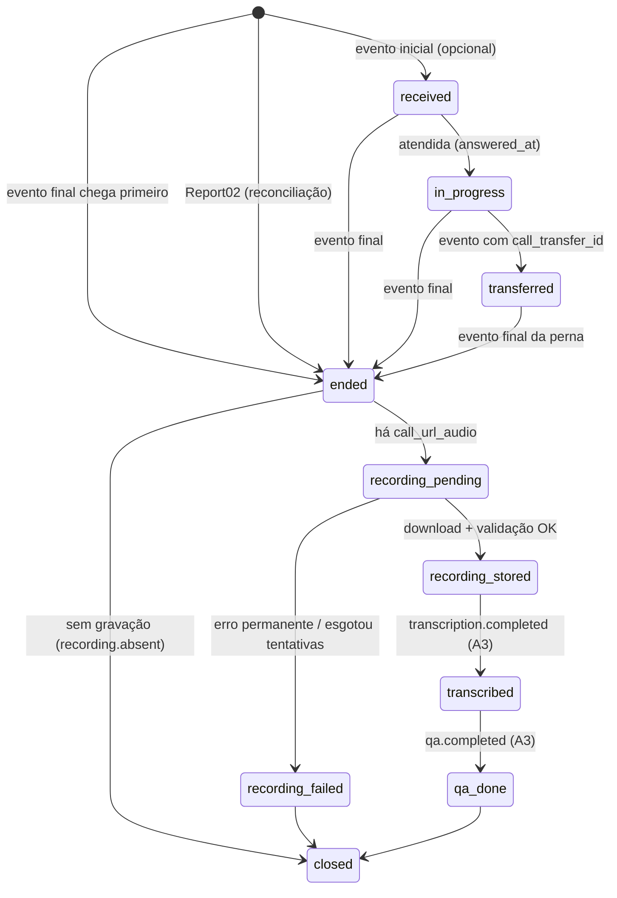
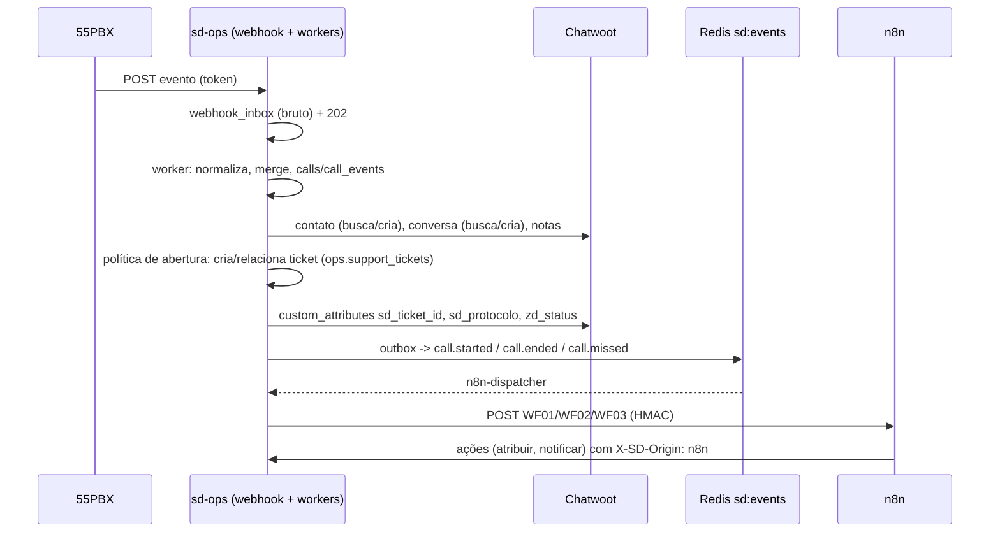

# Ciclo de vida dos eventos: ligação, gravação, transcrição, QA e ticket

Versão 1, de 2026-10-13 (agente A1). Base: `55PBX_API_MAPPING.md` (campos e divergências), decisões de arquitetura (sd-ops, Redis DB 7, stream `sd:events`) e a pbx-bridge já testada. A implementação é do A2 (schema `ops`) e do A3 (schema `qa`); este documento é o contrato de comportamento.

## 1. Princípios

1. **Persistir antes de processar.** O webhook grava o corpo bruto em `ops.webhook_inbox` e responde `202` em < 300 ms. Normalização, Chatwoot, áudio e IA rodam em workers.
2. **Nada depende da ordem nem do evento inicial.** A 55PBX não documenta ID de evento, ordem, retentativa nem garante o envio inicial (divergências D2/D3). Cada evento é uma "fotografia" da ligação; o estado é o **merge monotônico** das fotografias.
3. **Idempotência por chave determinística.** Ver §3.
4. **Reconciliação é parte do fluxo, não exceção.** O Report02 é a fonte de verdade tardia: perdidas, abandonadas, transferências e eventos não entregues entram por ele (poller + WF09).
5. **Eventos de domínio** são publicados no Redis Stream `sd:events` (DB 7) pelo padrão *outbox* (`ops.outbox` na mesma transação; um publicador move para o stream). Consumidores: workers do sd-ops, QA (A3), n8n (via ponte HTTP, §6).

## 2. Máquina de estados da ligação (`ops.calls.state`)



Regras de merge (função pura, testável):

| Regra | Comportamento |
|---|---|
| Monotonicidade | o estado só avança na ordem `received < in_progress < transferred < ended < recording_* < transcribed < qa_done < closed`. Evento "mais antigo" que chega depois **não retrocede** o estado, mas pode **preencher campos vazios** |
| Campos | valor não vazio substitui vazio; valor não vazio diferente do atual só substitui se a fonte tiver precedência maior: `report02` > `webhook final` > `webhook transfer` > `webhook inicial`. Divergências ficam em `ops.call_events.diff` para auditoria |
| Final antes do inicial | o inicial atrasado vira só `call_event` (registro) + preenchimento de vazios; não reabre a ligação |
| Final duplicado | mesmo `dedupe_key` → descartado no `INSERT ... ON CONFLICT DO NOTHING`; corpo diferente com mesma fase → nova linha `call_events` (versão), merge pela regra acima |
| Ticket | a criação/vínculo do ticket acontece **uma vez por ligação** (constraint única `ops.ticket_calls(call_id)` para o vínculo primário) |

## 3. Chaves de idempotência

| Objeto | Chave | Onde |
|---|---|---|
| Evento bruto | `sha256(central_id | call_id | fase_inferida | corpo_canônico)` | `ops.webhook_inbox.dedupe_key` UNIQUE |
| Ligação | `(tenant_id, provider='55pbx', central_id, provider_call_id)` | `ops.calls` UNIQUE |
| Perna de transferência | `(call_id_pai, provider_call_id_filha)` | `ops.call_legs` UNIQUE |
| Gravação | `(call_id, source_filename ou sha256(source_url))` | `ops.call_recordings` UNIQUE |
| Transcrição | `(recording_id, engine, engine_version, prompt_version)` | `qa.transcriptions` UNIQUE (A3) |
| QA | `(transcription_id, rubric_version, model)` | `qa.evaluations` UNIQUE (A3) |
| Nota no Chatwoot | `source_id = 55pbx:<call_id>:<parte>` / `sdops:<ticket_id>:<evento>:<seq>` | conferido via `GET messages` antes de criar |
| Conversa | atributo `pbx_call_id` / `sd_ticket_id` | `POST /conversations/filter` antes de criar |
| Evento de domínio | `event_id` UUIDv5(`tipo` + chave do objeto + versão) | consumidores guardam `processed_event_ids` |
| Chamada do n8n ao sd-ops | header `Idempotency-Key` (UUID por execução+nó) | `ops.idempotency_keys` (24 h) |

Sem ID de evento do provedor, a chave usa o conteúdo **com versão** (`dedupe_v1`); se o formato mudar, a versão muda e o histórico continua válido.

## 4. Classificação da fase do evento 55PBX

```
se call_transfer_id preenchido               -> fase = transfer
senão se call_url_audio, call_time>0, call_duration>0, call_total_time>0 ou call_status preenchido -> fase = final
senão                                         -> fase = initial
```
`phase_inferred = true` sempre (não há campo oficial). `call_type = sms` → `ignored_sms`.

## 5. Eventos de domínio (`sd:events`)

> **Contrato vinculante:** `WEBHOOK_CONTRACTS.md` §8.2 (A2, código do sd-ops). Diferenças em relação à proposta abaixo: o corpo do evento fica em **`payload`** (não `data`), o ID em **`id`**, existe `caused_by`, os tipos incluem `recording.failed` e `callback.created`, e os `outcome` são `missed`, `abandoned_ura`, `abandoned_queue`, `after_hours`, `dropped`. `transcription.completed`/`qa.completed` são publicados pelo A3. Os workflows n8n seguem o §8.

Envelope proposto (histórico da proposta A1):

```json
{
  "event_id": "uuid",
  "type": "call.ended",
  "version": 1,
  "occurred_at": "2026-10-13T18:00:00Z",
  "tenant_id": "b2b",
  "source": "sd-ops",
  "correlation_id": "uuid (trace por ligação/ticket)",
  "subject": {"call_id": "uuid", "provider_call_id": "1479477009.5199", "ticket_id": "uuid|null", "conversation_id": 123},
  "data": {}
}
```

| Tipo | Quando | `data` (mínimo) | Consumidores |
|---|---|---|---|
| `call.started` | 1º registro de uma ligação (evento inicial **ou** primeiro evento de qualquer fase) | `direction`, `remote_number_masked`, `branch_mask`, `queue_name`, `contact_id` | sd-console (CTI tempo real), WF01 |
| `call.ended` | ligação entra em `ended` | + `outcome`, `total_seconds`, `talk_seconds`, `wait_seconds`, `hangup_side`, `has_recording` | WF02, dashboards |
| `call.transferred` | perna nova relacionada | `from_branch`, `to_branch`/`to_queue`, `leg_seq` | sd-console, WF02 |
| `call.missed` | `outcome` ∈ `abandoned_queue`,`abandoned_ivr` (e `no_answer` receptiva) | `outcome`, `queue_name`, `callback_task_id` | WF03 |
| `recording.stored` | áudio validado no storage | `recording_id`, `duration_s`, `bytes`, `sha256`, `storage_key` (sem URL) | QA (A3) |
| `transcription.completed` | STT concluído (A3) | `transcription_id`, `language`, `confidence`, `partial` | QA (A3), WF02 |
| `qa.completed` | avaliação gerada (A3) | `evaluation_id`, `score`, `critical_alerts[]`, `rubric_version` | WF11, sd-console |
| `ticket.created` / `ticket.status_changed` / `ticket.reopened` / `ticket.escalated` | domínio de ticket (sd-ops) | `protocolo`, `from`, `to`, `actor` | WF04, WF06, WF07, WF08 |
| `sla.warning` / `sla.breached` | job do SLA | `policy`, `metric`, `due_at` | WF10 |

Os seis primeiros nomes (`call.started`, `call.ended`, `call.transferred`, `call.missed`, `recording.stored`, `transcription.completed`, `qa.completed`) são os fixados na decisão de arquitetura. Os de ticket/SLA são propostos aqui e precisam ser confirmados pelo A2.

Retenção do stream: `MAXLEN ~ 100000`; grupos de consumidores com `XACK`; mensagens pendentes há > 5 min são reclamadas (`XAUTOCLAIM`); após 5 entregas vão para `sd:events:dlq`.

## 6. Ponte para o n8n

O n8n **não** lê o Redis. O sd-ops tem um consumidor `n8n-dispatcher` que faz `POST` assinado (HMAC, `WEBHOOK_CONTRACTS.md` §3) para os webhooks dos WF01–WF12 conforme uma tabela de roteamento (`ops.automation_routes`: tipo → URL). Cada entrega gera `ops.automation_executions` (status, tentativas, resposta). Falha → retentativa exponencial (30 s … 1 h, 8 tentativas) → DLQ com alerta.

## 7. Gravação

| Passo | Regra |
|---|---|
| 1. Evento final com `call_url_audio` | cria `call_recordings(status=pending, source_url cifrada)` |
| 2. Espera inicial | 2 min (a 55PBX processa o arquivo após o fim) |
| 3. Download | só hosts permitidos, sem redirect, TLS, limite de bytes, timeout 60 s |
| 4. Validação | tipo (RIFF/WAVE, GSM, MP3), tamanho > 0, duração (ffprobe) coerente com `talk_seconds` (± 10 s ou flag `duration_mismatch`), sha256 |
| 5. Armazenamento | storage privado (adapter: volume local por padrão, MinIO/S3 opcional), chave `recordings/{tenant}/{yyyy}/{mm}/{call_uuid}.{ext}`; MP3 derivado opcional |
| 6. Publica `recording.stored` | — |
| Retentativas | 404/5xx/rede: 5, 10, 20, 40 min … até 6 h (12 tentativas); 401/403/host fora da lista/tamanho: falha permanente, sem retentativa; esgotado → `recording_failed` + alerta + reconciliação diária tenta de novo uma vez |
| Acesso | só por URL assinada de curta duração (≤ 5 min) emitida pelo sd-ops após checar permissão; cada acesso gera `ops.audit_events(action='recording.play')`. A URL original da 55PBX nunca é exibida ao cliente final |

## 8. Reconciliação (poller + WF09)

| Item | Valor |
|---|---|
| Fonte | Report02, janela deslizante |
| Frequência | poller interno a cada 10 min (últimas 3 h, com sobreposição); WF09 diário 03:00 (D-1 inteiro) e sob demanda (período) |
| Ações | ligação ausente → cria (fonte `report02`); presente → merge; perna com `call_id_origin` → `call_legs`; `type_call=call_abandoned` → `call.missed` se ainda não emitido |
| Estado | `ops.integration_sync_logs` (janela, contagens: novas, atualizadas, divergentes, erros) + health |
| Proteção | o WF09 só **pede** a reconciliação ao sd-ops (`POST /sd-ops/api/v1/reconciliations`); quem escreve é o sd-ops |

## 9. Ticket (resumo; detalhe em `TICKET_DOMAIN.md`)



---

## Implementação sd-ops

Versão 1, de 2026-10-13 (agente A2). Descreve o que o código do sd-ops faz (`servicedesk/integrations/pbx-bridge/sd_ops/`, branch `feat/integracao-55pbx`). Em caso de diferença com as seções acima, vale esta seção.

### A. Do webhook ao banco

```
55PBX ─POST/PUT─► /integracoes/55pbx/webhook/<segredo>  (ou /sd-ops/api/v1/webhooks/55pbx/<segredo>)
   segredo (hash -> tenant) · header token · IP · tamanho · ENABLED
   └─► ops.webhook_inbox (corpo bruto, dedup = sha256(fonte|tenant|sha256(corpo))) ─► 202
worker inbox (FOR UPDATE SKIP LOCKED + lease)
   └─► fix ISODate("…") · parse (JSON/lista/embrulho/form) · canonicalize · fase
       └─► 1 transação: call_events (dedup) → call_legs → calls → tickets/SLA/retorno/gravação → outbox
worker outbox (ordem FIFO por chave) ─► Chatwoot (API pública) · download da gravação · XADD sd:events · n8n
```

Nada lento roda no request: o webhook só grava e responde. A transação da chamada não faz I/O externo; o que depende de Chatwoot, 55PBX, Redis ou n8n vai para `ops.outbox`.

### B. Campos lidos

| Fonte | Campo | Normalizado | Coluna |
|---|---|---|---|
| tempo real | `call_id` | `call_id` | `call_legs.provider_call_id` |
| tempo real | `central_id` | `central_id` | `calls.central_id` |
| tempo real | `branch_mask` (Report02: `branch_number_agent`) | `branch` | `call_legs.branch` / `calls.branch` |
| tempo real | `branch_email` | `branch_email` (e-mail do ramal na 55PBX) | dados da perna |
| ambos | `call_type` / `type_call` (`active`, `receptive`, `ativo`, `receptivo`, `sms`) | `type` = `ativo`, `receptivo`, `interno`, `sms` | `direction` |
| ambos | `call_number` + `call_area_code` + `call_country_code`/`wg_country_code` | E.164 | `calls.number_e164` |
| ambos | `call_queue` / `queue_name` | `queue` | `queue` |
| ambos | `call_ura` / `way_ura` / `wk_ivr_*` | `ura` / `ivr` | `ura` |
| tempo real | `call_status` | `status_raw`, `status_key` | `status_raw` → `outcome` (`CALL_STATUS_MAP`) |
| ambos | `call_disconnection` | `disconnection` (`operador`/`cliente`/texto) | `disconnection` |
| tempo real | `call_time`, `call_duration`, `call_total_time` | `total_duration`, `spoken` (ver C) | `total_s`, `talk_s` |
| Report02 | `call_time_total_duration`, `call_time_spoken` (`HH:MM:SS`) | idem | idem |
| ambos | `call_time_waiting` | `waiting` | `wait_s` |
| ambos | `call_url_audio` | `audio_url` | `call_recordings.source_url` (nunca exposta) |
| tempo real | `call_audio_file` | `audio_file` | dados da perna |
| tempo real | `call_transfer_id` | `transfer_id` (ID da **nova** ligação) | `call_legs.transfer_to_provider_call_id` |
| Report02 | `call_id_origin` | `origin_call_id` | `call_legs.transferred_from_leg_id` |
| Report02 | `wl_time_attended` | `attended_at` | `answered_at` |
| tempo real | `call_rating*` (pesquisa) | `rating`, `rating_*` | `ops.csat_responses` |
| tempo real | `call_cost`, `call_tax`, `call_tax_type` | `cost`, `tax`, `tax_type` | dados da perna |
| tempo real | `call_balance` | descartado (saldo da conta, não é dado da ligação) | — |
| ambos | `call_document` (CPF/CNPJ), `call_order` | `cpf`, `order` | só dados da perna; nunca no stream, na API ou em log sem máscara |

### C. Inconsistências da documentação e o que foi decidido

| # | Inconsistência | Decisão (configurável) | Validar com tráfego real |
|---|---|---|---|
| C1 | Tabela: `call_time` = "tempo efetivo", `call_duration` = "duração total". Exemplos: `call_time` 11 > `call_duration` 3 (PDF, 11 = 3 + 8 de espera) e 44 > 9 (readme, `call_total_time` = 44) | `PBX_RT_TIME_FIELDS=examples` (padrão): `call_time` = total, `call_duration` = falado. `descriptions` = a tabela. Se falado > total, troca e registra `time_fields_swapped`; `call_total_time` vence como total | sim |
| C2 | PDF: 2 envios por ligação (início e fim) + 3º na transferência. Readme: "a cada final de ligação **atendida**" | a máquina de estados não depende do envio inicial; não atendidas também chegam pelo Report02 | sim: as não atendidas chegam no tempo real? |
| C3 | `call_status`: só aparece `call_attended` | `CALL_STATUS_MAP` com palpites marcados; desconhecido → heurística (D) e o valor bruto fica em `status_raw` | sim: lista de valores |
| C4 | `call_date` como `ISODate("…")` (literal Mongo, JSON inválido) e "Invalid Date" no exemplo do readme | o literal é convertido para string antes do parse; data inválida → hora do recebimento + anomalia `call_date_invalid` | sim: formato real |
| C5 | `call_transfer_id`: "ID da nova ligação gerada pela transferência" no 3º envio | perna atual → perna nova (placeholder `pending` até chegar). Report02 usa `call_id_origin` no sentido inverso | sim |
| C6 | Header de validação: `token` (PDF, "Chave (token)" opcional) | conferido quando a conta tem `webhook_token_ref`; o segredo no caminho continua obrigatório | sim: nome exato do header |
| C7 | Report02: o exemplo de filtros tem 9 segmentos (`…/report_02/quiz/interval/timezone`), o OpenAPI de `report_02` tem 8 | mantido o formato de 9 segmentos, testado pela pbx-bridge contra mock | sim |
| C8 | Discagem: URL `…:20500/api/webphone/dial` (introdução) × `…:20500/api/pbx/webphone/dial` (OpenAPI) | `PBX_DIAL_URL` | sim |

### D. Estados e resultado

- **Perna** (`call_legs.state`): `pending` (prevista por transferência) → `started` → `ended` ou `transferred`. Recalculada do zero a cada evento a partir de todos os `call_events` dela, ordenados por `(rank, id)`; início = rank 1, fim/transferência/relatório = rank 2. Um início atrasado não sobrescreve o fim.
- **Chamada lógica** (`calls.state`): `active` → `ended`; `merged` quando a perna transferida chegou antes e virou outra chamada (as duas são unidas; o ticket automático ainda `novo` da chamada absorvida é cancelado com o motivo "mesclado no protocolo …").
- Encerrada = nenhuma perna `pending`/`started`. Chamada parada em `active` por mais de 6 h (perna anunciada que nunca chegou) é encerrada pela manutenção com auditoria `call.finalized_stale`.
- **Resultado** (`calls.outcome`), na ordem: alguma perna com tempo falado ou `answered_at` → `answered` (recusa de um operador **não** vira perdida se outro atendeu); senão o `CALL_STATUS_MAP` da última perna; senão ativa → `failed`; interna → `missed`; receptiva fora do horário "Padrão B2B" → `after_hours`; com fila → `abandoned_queue`; com URA → `abandoned_ura`; senão `missed`. `rejected` numa receptiva de uma perna só → `missed`.
- **Retorno** (`callback_tasks`): receptiva com número, resultado em `CALLBACK_OUTCOMES`; abandono com espera e duração < `SL_SHORT_ABANDON_S` (5 s) não gera retorno; prazo = agora + `CALLBACK_DUE_MIN` em horas úteis. Uma ligação ativa atendida para o mesmo número conclui os retornos pendentes.

### E. Idempotência (chaves reais)

| Objeto | Chave |
|---|---|
| corpo recebido | `webhook_inbox.dedup_key` = sha256(`fonte|tenant|sha256(corpo)`) |
| evento | `call_events.dedup_key` = sha256(`v1|tenant|call_id|fase|JSON normalizado ordenado`) — o mesmo dado vindo com outra formatação ou pelo Report02 não gera efeito novo |
| perna | único (`tenant_id`, `provider_call_id`) |
| chamada ↔ ticket | PK (`ticket_id`, `call_id`); política aplicada só se a chamada ainda não tem ticket |
| gravação | único `leg_id` |
| outbox | `dedup_key` único por efeito (`sync_call:<evento>`, `recfetch:<gravação>`, `stream:<id>`, `deliver:<rota>:<id>`) |
| evento do stream | `id` = UUIDv5(`tipo|tenant|chave natural`): `call.started` → chamada; `call.ended` → chamada + nº de pernas; `call.transferred` → perna de origem + call_id novo; `call.missed` → chamada; `recording.stored` → gravação; `ticket.*` → ticket + versão |
| nota no Chatwoot | `source_id` `55pbx:<call_id raiz>:<parte>` (registro, atualizacao, acao_*, gravacao, `perna:<id>`, `gravacao:<id>`) e `sdops:<ticket>:atividade:<id>`, conferidos antes de criar |
| conversa | atributo `pbx_call_id` (filtro) antes de criar |
| chamadas do n8n | `Idempotency-Key` em `ops.idempotency_keys` (24 h) |

Concorrência: o processamento de chamadas de um tenant é serializado por `pg_advisory_xact_lock` (transações curtas, sem I/O). Inbox e outbox usam `FOR UPDATE SKIP LOCKED` e lease (`SDOPS_LEASE_S`, 120 s): item reservado por um processo que morreu volta para a fila sozinho. A outbox só entrega o item N de uma chave (`call:<id>`, `ticket:<id>`) depois do N-1.

### F. Falhas

| Situação | Comportamento |
|---|---|
| Chatwoot fora | o ticket e a chamada existem no sd-ops; os itens `chatwoot.*` voltam com backoff (15 s … 1 h); `OUTBOX_MAX_ATTEMPTS` (10) → DLQ (`status=dead`), visível em `/admin/dlq`, `health.outbox_dead` e `integration_sync_logs`; reprocessar = `POST /admin/dlq/outbox/<id>/retry`. Circuit breaker: 5 falhas seguidas → pausa de 60 s sem gastar tentativas |
| 55PBX fora (Report02) | `reconciliation_runs.status=error`, `health.last_poll_error`; a próxima passada cobre a janela (sobreposição de 3 h) |
| 55PBX fora (discagem) | resposta real ao CTI (`502`, "55PBX indisponível"); nada é simulado |
| Gravação ausente | sem `call_url_audio`: não cria gravação; `call.ended.has_recording_url=false` |
| Gravação atrasada/rede | 404/5xx/rede: 5, 10, 20, 40 min … 6 h, até `RECORDING_MAX_ATTEMPTS` (12) → `recording.failed` |
| Gravação incompleta | duração < 50% do tempo falado: espera mais `RECORDING_SHORT_RETRIES` (2) vezes e então guarda com `integrity=short`; diferença > max(10 s, 10%) → `duration_mismatch` |
| Erro permanente | 401/403, host fora de `AUDIO_ALLOWED_HOSTS`, maior que `AUDIO_MAX_MB`, tipo não reconhecido, duração > 4 h → `failed` sem novas tentativas |
| Banco do sd-ops fora | o webhook responde **503** sem aceitar nada (a 55PBX pode reenviar; o Report02 recupera) |
| Payload irreconhecível | `webhook_inbox.status=unparsed`, guardado para análise, log mascarado |

### G. Gravação (até `recording.stored`)

Espera inicial `RECORDING_INITIAL_DELAY_S` (120 s) → download só de `AUDIO_ALLOWED_HOSTS` (`*.55pbx.com`, `*.55pbx.com.br`), sem seguir redirecionamento, com limite de bytes → tipo pelo conteúdo (RIFF/WAVE, MP3, Ogg, AMR) → duração pelo cabeçalho WAV (PCM e GSM/WAV49) ou ffmpeg → SHA-256 → storage privado (`recordings/<tenant>/<AAAA>/<MM>/<id>.<ext>`, arquivo 0600) → `recording.stored` → cópia MP3 anexada à conversa (opcional, `CHATWOOT_ATTACH_RECORDING`). Acesso só por URL assinada de 300 s, auditada.

### H. Reconciliação

Poller a cada `POLL_INTERVAL_MIN` (10) sobre os últimos `POLL_LOOKBACK_MIN` (180); histórico por `POST /sd-ops/api/v1/reconciliations` ou `python -m sd_ops reconcile --from --to` em blocos de 6 h. As linhas entram na mesma inbox (`source=report02`) e passam pela mesma máquina de estados: ligação desconhecida é criada; conhecida só completa dados; nada duplica. Cada bloco grava `ops.reconciliation_runs`.

### I. O que precisa ser validado com a 55PBX (e com o cliente)

1. Exemplo real do "Tempo real por URL" (POST ou PUT? JSON com `ISODate`?), confirmando C1–C6 e se há envio para não atendidas.
2. Valores possíveis de `call_status` e `call_disconnection` → completar `CALL_STATUS_MAP`.
3. IPs de origem (para `ALLOWED_IPS`) e se o header `token` é enviado.
4. Discagem: `client_code`, `api_key`, JWT, URL correta (C8), se o `call_id` devolvido é o mesmo do webhook.
5. Gravações: liberação do IP da VPS e se exigem autenticação (LGPD).
6. Menu Dinâmico: variável com o número do chamador (para `?ani=`), timeout da URA, método e tipo de autenticação escolhidos no painel.
